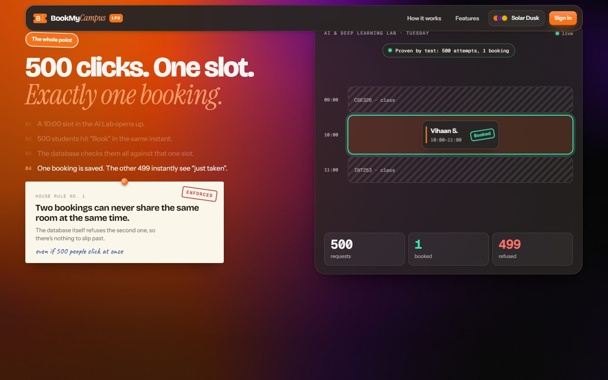

<div align="center">

# BookMyCampus

**Every lab, hall and turf at Lovely Professional University, bookable from one place.**

Django · PostgreSQL · React

[Screens](#a-look-around) · [Roles](#who-can-do-what) · [Run it](#run-it-locally) · [Hosting](#hosting) · [How double-booking is prevented](#why-two-people-cant-book-the-same-slot) · [Tests](#tests)

<br>


</div>

<br>

Booking a room at a university usually means a WhatsApp chain, a register book and a phone call to someone in Block 34. BookMyCampus replaces that with one catalogue of 32 seeded resources across seven types: classrooms, labs, instruments, seminar halls, sports facilities, meeting rooms and vehicles.

You can see what is free right now, because the calendar already knows the timetable. You book it, get a QR pass, and scan in at the door. If you don't turn up, the slot goes back to everyone else.

Built for problem statement **P20: Campus Resource, Lab and Facility Booking Platform** (Track P). It is a student project with seeded demo data, not an official LPU system.

## A look around

### Getting in

<table>
<tr>
<td width="50%"><br><sub><b>Sign up.</b> Registration number, name, department and a new password.</sub></td>
<td width="50%"><br><sub><b>Sign in.</b> With one-click demo personas for trying it out.</sub></td>
</tr>
</table>

### Find a room, pick a slot

<table>
<tr>
<td width="50%"><br><sub><b>Explore.</b> Search, filter by type, block or size, or show only what is free this hour.</sub></td>
<td width="50%"><br><sub><b>Room calendar.</b> Classes, maintenance and other bookings are locked. Drag across what's left.</sub></td>
</tr>
<tr>
<td><br><sub><b>Just me, or for a class.</b> A student's class booking always goes to the HOD.</sub></td>
<td><br><sub><b>Taken slots aren't a dead end.</b> Join the waitlist, or take a similar room free at that exact time.</sub></td>
</tr>
</table>

### Your pass, your week

<table>
<tr>
<td width="50%"><br><sub><b>The pass.</b> QR code, live status, calendar export.</sub></td>
<td width="50%"><br><sub><b>My bookings.</b> Upcoming, calendar and history.</sub></td>
</tr>
<tr>
<td><br><sub><b>My calendar.</b> A faculty member's week at a glance.</sub></td>
<td><br><sub><b>Campus map.</b> How much of each block is free this hour.</sub></td>
</tr>
<tr>
<td colspan="2"><br><sub><b>Profile.</b> Show-up rate, no-show record, calendar sync, your details and password.</sub></td>
</tr>
</table>

### Campus Copilot

Press <kbd>Ctrl</kbd> + <kbd>K</kbd> anywhere and ask in plain words. Copilot reads live data and can book, cancel or report a fault for you.

<table>
<tr>
<td width="50%"></td>
<td width="50%"></td>
</tr>
</table>

### The HOD's side

<table>
<tr>
<td width="50%"><br><sub><b>Approval queue.</b> Who asked, for what, for which class.</sub></td>
<td width="50%"><br><sub><b>Control room.</b> Utilisation, idle assets and no-shows.</sub></td>
</tr>
<tr>
<td colspan="2"><br><sub><b>Catalogue.</b> Add and edit resources, or import them from a CSV.</sub></td>
</tr>
</table>

### Six themes, light and dark

<table>
<tr>
<td width="33%"><br><sub>Cosmic Night</sub></td>
<td width="33%"><br><sub>Northern Lights</sub></td>
<td width="33%"><br><sub>Quantum Rose</sub></td>
</tr>
</table>

### On a phone

<table>
<tr>
<td width="33%"></td>
<td width="33%"></td>
<td width="33%"></td>
</tr>
</table>

## Who can do what

The login screen offers three demo personas. The password for all of them is `campus123`.

| Sign in as | Role | What they can do |
|---|---|---|
| `demo.student` | Student, CSE | Book for themselves or a class, check in by QR, save rooms, join waitlists |
| `demo.faculty` | Faculty, CSE | All of that, plus repeat a booking weekly and book seminar halls and vehicles |
| `demo.head` | HOD, CSE | Approve or reject requests, add rooms, see department usage |

Real students register at `/register` with their 8-digit registration number and sign in with that. Sign-up always creates a Student account. Other roles are given by an administrator.

An HOD sees requests from their own department and requests for rooms their department owns.

`demo.manager` and `demo.admin` also exist for campus-wide setup such as rules, workflows and people. They aren't on the login screen, but you can sign in with them normally. `demo.admin` also has Django admin at `/django-admin/`.

### Try the whole story in two minutes

1. Sign in as **Student**, open a room, click a free slot, choose **For a class**, enter `K22CS-B` and send the request.
2. Sign in as **HOD**, open **Approvals** and approve it.
3. Back as **Student**, the booking is confirmed, with a notification and a QR pass.
4. Click a grey **Booked** block on any room. See the free alternatives and choose **Tell me if it frees up**.
5. Whoever holds that booking cancels it, and the student is notified straight away.

## What's in it

**Booking**
- Single bookings, and weekly series that skip clashing dates or book nothing at all, your choice
- Opening hours, minimum and maximum length, notice period, booking window, blackout dates and quotas
- Approval chains set per resource type and requester role, editable without a redeploy
- A waitlist that notifies you when a slot opens up, plus free alternatives for any taken slot
- A **best time to book** chart on each room, built from four weeks of real usage
- Saved rooms, a **Next up** strip and a personal calendar

**On the day**
- QR check-in: scan the poster on the door, or have a staff member scan your pass
- 15 minutes' grace, then the slot is released automatically
- No-shows count against you: a warning, then a 7-day pause, then a 30-day pause
- Finish early and check out, and the rest of your time goes back to the pool

**Running the campus**
- Timetable sync over a webhook or by pulling from a URL. A republish moves any bookings that now clash
- Maintenance windows and one-tap breakdown reports that notify affected bookings
- Consumables with stock counts that can't oversell, issued alongside a booking
- Analytics for utilisation, idle assets, a weekday-by-hour heatmap, no-shows, demand and approval times
- CSV bulk import and printable QR door posters

**Everywhere**
- Live notifications over Server-Sent Events, plus email if you configure SMTP
- A personal iCal feed for Google, Outlook or Apple Calendar, and `.ics` for single bookings
- Campus Copilot: an AI agent with seven tools, running on Groq with key rotation and model fallback
- <kbd>/</kbd> opens a command palette to jump to any page, room or theme

## Run it locally

You need **Python 3.12+**, **Node 20+** and **Docker Desktop**.

**1. Start PostgreSQL and Redis**

```bash
docker compose up -d
```

**2. Start the backend**

```bash
cd backend
python -m venv .venv
source .venv/bin/activate          # Windows PowerShell: .venv\Scripts\Activate.ps1
pip install -r requirements.txt
cp .env.example .env
python manage.py migrate
python manage.py seed_demo --reset
python manage.py runserver 127.0.0.1:8000
```

> [!WARNING]
> `seed_demo --reset` deletes every user and booking in the database, including students who registered themselves. Run it once when setting up, not before a demo that people have signed up for.

**3. Start the frontend** in a second terminal

```bash
cd frontend
npm install
npm run demo
```

Open **http://localhost:5173**. `npm run demo` serves an optimised production build, which is the one to present with. Use `npm run dev` for hot reload while working on the code.

Background jobs such as auto-release and reminders run inside `runserver` while `AUTO_SWEEP` is on, so you don't need anything extra in development. For a production-style setup, turn it off and run Celery:

```bash
celery -A config worker -B -l info
```

### Configuration

Everything lives in `backend/.env`, and the defaults in `.env.example` work for local development.

| Variable | What it does |
|---|---|
| `GROQ_API_KEYS` | Comma-separated Groq keys for Campus Copilot. Copilot needs at least one to answer |
| `GROQ_MODEL`, `GROQ_FALLBACK_MODELS` | Which models Copilot uses, in order |
| `POSTGRES_*`, `REDIS_URL` | Database and Redis. Docker publishes PostgreSQL on port **5433** |
| `FRONTEND_URL`, `CORS_ALLOWED_ORIGINS` | Where the frontend is served from |
| `TIMETABLE_SOURCE_URL`, `TIMETABLE_WEBHOOK_TOKEN` | Timetable sync |
| `AUTO_SWEEP` | Run background sweeps inside the web process |
| `EMAIL_*` | Real email delivery. Emails print to the console by default |

Never commit `.env`. It is already in `.gitignore`.

## Hosting

The frontend goes on **Vercel** and the Django API and database go on **Render**, because live notifications and the auto-release job need a long-running server.

**Render:** choose **New → Blueprint** and select this repo. `render.yaml` creates the database and the API, runs migrations and loads the demo data on the first deploy. Then add `FRONTEND_URL` and `CORS_ALLOWED_ORIGINS` with your Vercel address.

**Vercel:** import the repo with `frontend` as the root directory and the Vite preset. `frontend/vercel.json` forwards `/api` to `https://bookmycampus-api.onrender.com`, so change it if Render gives your service a different address.

On a hosted demo `demo.manager` and `demo.admin` use the generated `DEMO_ADMIN_PASSWORD` instead of `campus123`, and you can read it in the Render dashboard. The persona buttons stay available to anyone, so don't keep real student data on a public demo.

## Why two people can't book the same slot

The obvious approach is to check that a slot is free and then insert the booking. That is a race: two requests can both pass the check at the same moment, and both insert.

So the application never makes that check. Every booking stores its time as a PostgreSQL range, and the table carries an exclusion constraint:

```python
ExclusionConstraint(
    name="booking_no_overlap",
    expressions=[("resource", RangeOperators.EQUAL), ("period", RangeOperators.OVERLAPS)],
    condition=Q(status__in=["pending", "confirmed", "checked_in"]),
)
```

The database refuses the second row, however many servers are running, and that refusal becomes a clear `409` saying what is in the way. A second constraint on a shared occupancy ledger applies the same rule across bookings, timetabled classes and maintenance.

`test_concurrency.py` proves it the hard way: 500 threads, each with its own database connection, are released at the same instant at one slot, and exactly one booking must exist afterwards. The full reasoning is in [docs/CONFLICT_PREVENTION.md](docs/CONFLICT_PREVENTION.md).

<p align="center">
  
  <br>
  <sub>The landing page tells the same story as you scroll: 500 requests, 1 booked, 499 refused.</sub>
</p>

## Tests

```bash
cd backend
python manage.py test
```

There are 262 backend tests, and all of them pass. PostgreSQL must be running, because the tests use real range types and real concurrent connections. A full run takes about five minutes.

| App | Tests | Covers |
|---|---|---|
| `bookings` | 78 | Engine, the 500-way race, HTTP API, class bookings, waitlist |
| `rules` | 37 | Availability, blackouts, quotas, policy |
| `approvals` | 32 | Workflow steps, queues, HOD routing |
| `accounts` | 29 | Sign-up, sign-in, profile, permissions |
| `analytics` | 14 | Utilisation, heatmap, idle capacity |
| `catalogue` | 14 | Search, CSV import, saved rooms |
| `consumables` | 14 | Stock and issuing |
| `timetable` | 14 | Publishing, webhook, displaced bookings |
| `maintenance` | 11 | Windows and breakdown reports |
| `ai_assistant` | 10 | Agent loop, key rotation, tools |
| `notifications` | 9 | Live stream and email |

### Acceptance criteria

| Criterion | Where to see it |
|---|---|
| 500 concurrent attempts, exactly one booking | `apps/bookings/tests/test_concurrency.py` |
| Timetabled slots are never offered | `test_timetabled_slot_never_offered`, `test_cannot_book_over_lecture` |
| Workflows change per type without a deployment | Control room → Rules & workflows |
| Mobile QR check-in, auto-release after grace | `/scan`, `CheckInAndReleaseTest` |
| No-show tracking with progressive restriction | `test_progressive_restriction`, Control room → Operations |
| Utilisation and idle capacity across 3+ types | Control room → Analytics, with seven types seeded |
| Recurring bookings with per-date conflict handling | `RecurringTest` |

## How it's built

| | |
|---|---|
| **Backend** | Django 5.2, Django REST Framework, SimpleJWT, PostgreSQL 16 (range types, `btree_gist`), Celery and Redis |
| **Frontend** | React 19, TypeScript, Vite, TanStack Query, React Router |
| **UI** | Tailwind CSS v4, shadcn/ui, tweakcn themes, React Bits, GSAP, Motion, Lenis |
| **Features** | FullCalendar, Leaflet with OpenStreetMap, Recharts, html5-qrcode |
| **AI** | Groq, using tool calling |

```text
backend/
  config/            settings, URLs, Celery
  apps/
    accounts/        users, roles, departments, sign-up, JWT
    catalogue/       resources, types, locations, saved rooms, seed_demo
    rules/           availability engine, blackouts, quotas, policy
    bookings/        engine, ledger, check-in, no-shows, waitlist, sweeps
    approvals/       workflows and decisions
    timetable/       timetable sync
    maintenance/     windows and breakdown reports
    consumables/     stock and issuing
    analytics/       snapshots, heatmap, utilisation
    notifications/   live stream and email
    ai_assistant/    Campus Copilot
frontend/src/
  pages/             Landing, Login, Register, Explore, ResourcePage, MyBookings,
                     BookingPage, Scan, Approvals, CampusMap, Profile, admin/
  components/        AppShell, CommandPalette, BookingTicket, ai/, shadcn/, reactbits/
  styles/            theme tokens and stylesheets
docs/                conflict prevention write-up, screenshots
```

### Main API routes

```text
POST /api/auth/register                    POST /api/auth/login
GET  /api/resources                        ?q= &type= &building= &free_from= &free_to= &saved=1
GET  /api/resources/:id/availability       GET  /api/resources/:id/insights
GET  /api/resources/:id/alternatives       POST /api/resources/:id/watch
POST /api/bookings                         POST /api/bookings/:id/approve | reject | cancel
POST /api/bookings/:id/check-in | check-out
POST /api/bookings/scan                    GET  /api/bookings/:id/ics
GET  /api/approvals/queue                  GET  /api/calendar/:token.ics
POST /api/timetable/publish                POST /api/maintenance/report
GET  /api/analytics/utilisation | heatmap | noshows | demand
POST /api/ai/chat                          GET  /api/notifications/stream
```

### Keeping the glass smooth

Glassmorphism can get slow, because blurred panels redraw whenever the pixels behind them change. So the app backdrop is rendered once as a still frame, and the landing page's burst is drawn once and then rotated by CSS. Cards don't carry their own blur, the catalogue uses native scrolling, and sections below the fold on the landing page load only after the hero settles.

## Known limits

- **Registration numbers aren't verified.** There is no connection to LPU's UMS, so someone could register with another student's number. A one-time code sent to an LPU email address would fix it.
- **No self-service password reset.** An administrator can reset a password from the People page.
- **Sign-in attempts aren't rate-limited yet.** Sign-up and password change are.
- **Any user can block a room with a breakdown report.** It lasts 24 hours until someone marks it repaired, so production would want a staff member to confirm reports first.
- **The phone camera needs HTTPS** for QR scanning, except on `localhost`.
- **Map pins are approximate** and can be corrected per location in the catalogue.

## Credits

Built by [Ankan Basu](https://github.com/ankan123basu) and [Ankit Basu](https://github.com/Ankit-Basu).

Conflict-prevention design is written up in [docs/CONFLICT_PREVENTION.md](docs/CONFLICT_PREVENTION.md). Room photos are from [Unsplash](https://unsplash.com), map data is © [OpenStreetMap](https://www.openstreetmap.org/copyright) contributors, and UI pieces come from [shadcn/ui](https://ui.shadcn.com), [React Bits](https://reactbits.dev) and [tweakcn](https://tweakcn.com).
